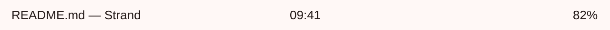

# Strand

A toolkit for Wayland shells. Write bars, launchers, lock screens and
panels in one small typed language; save the file and the running shell
follows.

**[Documentation](https://strand.jacobgrant.dev)** ·
[Install](https://strand.jacobgrant.dev/start/install.html) ·
[Guide](https://strand.jacobgrant.dev/guide/index.html) ·
[Playground](https://strand.jacobgrant.dev/playground.html)

```
bar Top {
  edge: top; height: 32
  split { pad: 0, 12
    start  { text windows.focused?.title ?? "" }
    center { text clock.format("%H:%M") }
    end    { text pct(battery.percent) }
  }
}
```

<picture>
  <source media="(prefers-color-scheme: dark)" srcset="site/media/hello-dark.png">
  
</picture>

That file is a bar on every monitor, themed and animated. It wakes once
a minute, for its clock.

- **Changes move on springs.** Change a value and its prop moves there.
  Spring curves are theme tokens you can retune.
- **Save, and the shell follows.** What you changed animates to its new
  value, and the rest keeps its state: an open popup, or the text typed
  into a launcher.
- **Checked before it runs.** Every name, field and type is known before
  the shell starts. A save that does not check leaves the last good
  shell running, and the check says what is wrong and where.
- **Runs where you do.** Strand runs on sway, Hyprland, niri and labwc,
  and every build is tested on all four.

## Status

Strand is young and has no packaged release yet: you build it from this
repository ([install](https://strand.jacobgrant.dev/start/install.html)).
The language may still change before 1.0.

```sh
git clone https://github.com/jakeb-grant/strand
cd strand
cargo build --release -p strand -p strand-auth
```

## Contributing

[`docs/development.md`](docs/development.md) covers the crates, building
and the test suite. [`docs/design.md`](docs/design.md) is the source of
truth for how Strand behaves, and
[`docs/decisions.md`](docs/decisions.md) records why.

## License

Strand is licensed under either of the [Apache License, Version
2.0](LICENSE-APACHE) or the [MIT license](LICENSE-MIT), at your option.
Unless you say otherwise, any contribution you submit for inclusion in
Strand is licensed the same way, with no additional terms or conditions.
