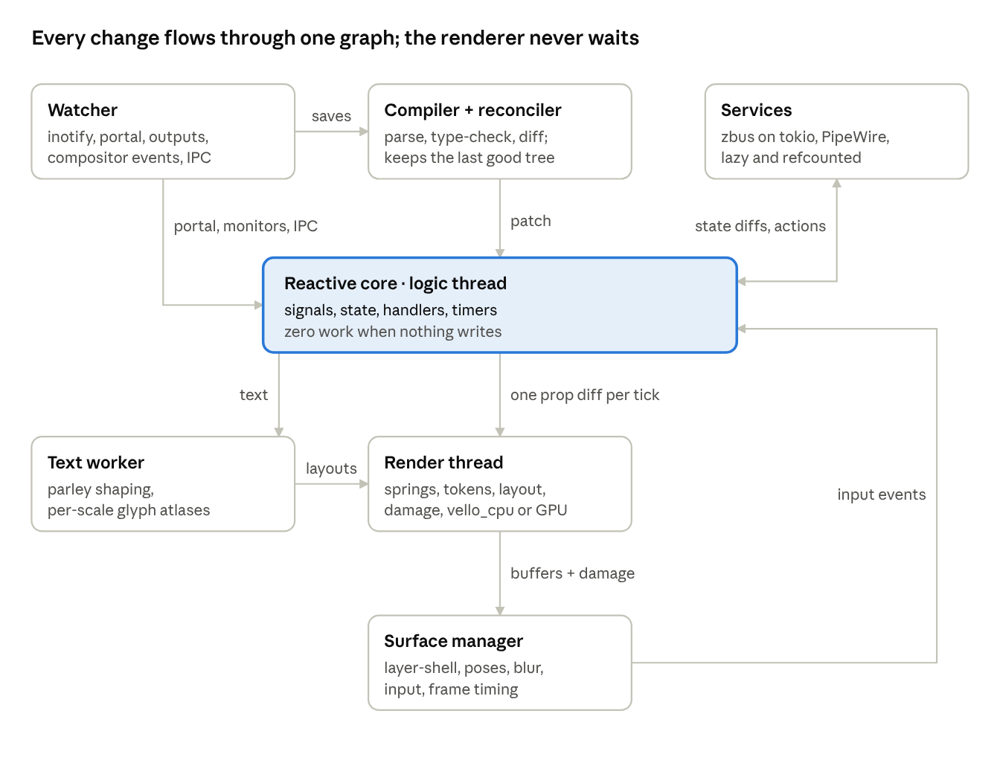
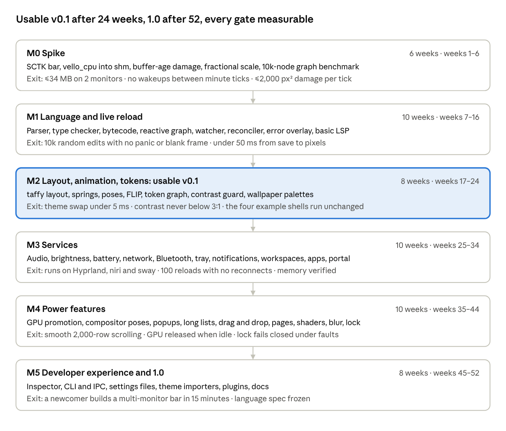

# Shell Toolkit Design: A First-Principles API

Oct 4, 2026 · @Jacob

## Summary

Build **Strand** (working name): a Rust shell toolkit where you write bars, launchers, OSDs and notification stacks in one small typed declarative language. Everything animates by default, nothing runs when nothing changes, and saving any file is a state change, not a restart.

This design came from 10 research agents, 3 competing API proposals, 4 lens critics, a synthesis, 2 adversarial reviews, a dedicated hot-reload pass and a fresh-eyes ergonomics review.

**Mental model.** A shell is a tree of nodes. Every property is a live expression over state, services and tokens. Every change, including a file save, a theme switch or a plugged-in monitor, flows through one reactive graph and reaches the screen through springs.

**Headline decisions**

1. **One language, no seam.** No markup-plus-script split, no string-keyed bridge. Bindings compile to bytecode that Rust evaluates; handlers are cancellable coroutines.
2. **Defaults remove ceremony.** A `bar` appears on every monitor, every visual prop is a spring, service items carry their own keys, files auto-load. There are no imports and no entry file.
3. **Few concepts, learned in layers.** One conditional-style form (`when`), source order wins like CSS, one loop form (`for`), one two-way binding (`<->`). A hello bar uses 6 concepts.
4. **Design tokens are runtime signals.** `$accent`, `$space.2` and friends live in the graph. A theme swap springs the palette in OKLab; nothing rebuilds.
5. **Hot reload is a reconcile, with real-time change detection.** Config directories, symlink targets, wallpapers, TOML settings, portal dark-mode and monitor hotplug all flow in live. State is kept by identity; a broken save keeps the last good tree.
6. **CPU-first rendering with exact damage.** vello\_cpu draws into shared memory, a clock tick repaints about 60×20 px, and the GPU starts only for heavy animation. Target: about 30 MB for a two-monitor bar.
7. **Blur is declared, never captured.** The compositor blurs through `ext-background-effect-v1` where supported, with a clear fallback ladder.

**The whole hello bar**

```
bar Top {
  edge: top; height: 32
  split {
    start  { text windows.focused?.title ?? "" }
    center { text clock.format("%H:%M") }
    end    { text pct(battery.percent) }
  }
}
```

That file is already on every monitor, reactive, themed and animated. It wakes once a minute.

## Lessons from prior art

Prior toolkits break at seams: between two languages, between window and scene graph, and between config file and running process. Strand removes each seam by construction.

| Project | Copy | Avoid |
| --- | --- | --- |
| [pleamar](https://github.com/k4ditano/pleamar) | A spring on every prop; render thread never waits on logic; true idle; no-code services; did-you-mean errors; last good scene on a broken save | Luau seam keyed by strings; `max N` capacities; colours fixed at compile time; silent redeclare; VM-restart reload; 250 ms polling; full-surface repaint; screen-capture blur |
| [Quickshell](https://github.com/quickshell-mirror/quickshell) | Bindings plus real layout; per-monitor `Variants`; `IpcHandler`; window reuse on reload | `modelData` ceremony; opt-in `Behavior on` animation; a GL context per popup; real configs at 0.5–1.26 GB |
| [AGS / Astal](https://github.com/Aylur/ags), [eww](https://github.com/elkowar/eww), Ignis | Fine-grained accessors; keyed `<For>`; `:run-while` polling only when visible | No reload, or a full reset and re-exec; shell scripts as the data layer |
| [ironbar](https://github.com/JakeStanger/ironbar), [ashell](https://github.com/MalpenZibo/ashell) | Per-field reload policy; keep the old config on error; directory inotify | File-only watches; a typo resets everything to defaults |
| Slint, React, Flutter | One front end for runtime and LSP; identity plus signature; derived values recompute on reload | Assignment silently kills bindings; new defaults ignored on reload; identity by position |
| SwiftUI, Material 3, W3C design tokens | Inherited environment values; runtime tokens; reference → system → component token tiers; separate springs for movement and effects | Order-sensitive modifier chains; tokens resolved at build time |

The heavy ones are heavy because a full runtime sits under every surface. The fragile ones reload by restarting, which forgets state and ignores new defaults. The verbose ones make you wire the same value twice: a property plus an `onChange`, or a fact plus a string key.

## Good vs bad vs ugly

The test for every API choice: does it remove a concept, or add one? Good design deletes wiring. Bad design adds friction you can learn around. Ugly design fails silently, and that is what makes shells feel fragile.

### Good: keep and build on

| Pattern | Elsewhere | Strand |
| --- | --- | --- |
| Defaults do the obvious thing | `Variants { model: Quickshell.screens; PanelWindow { required property var modelData …` | `bar Top { edge: top }` is on every monitor |
| Animation on by default | `Behavior on color { ColorAnimation { duration: 150 } }` | `bg: $accent` already springs |
| Services are typed live values | `Process { command: ["date"] }` plus a `Timer` | `clock.format("%H:%M")`, which wakes once a minute |
| One two-way binding | `value={v} onChange={…}`, then `open: x; on dismiss { x = false }` | `value: <-> audio.sink.volume`, `open: <-> open` |
| Time as vocabulary | `clearTimeout` / `setTimeout` bookkeeping | `after 6s while !hover { n.expire() }` |
| Inherited style plus tokens | `font.family` on every `Text` | `col { font: $font.ui; color: $fg … }` covers all children |
| Errors at load | `undefined` at runtime | `critcal` → "did you mean `critical`?" with file, line and caret |

### Bad: friction to design out

| Pattern | Problem | Fix adopted |
| --- | --- | --- |
| Several syntaxes for one idea | `:hover {}`, `when hover {}` and `self.hover` all mean the same | Only `when hover {}`; `hover` is a plain boolean of the enclosing node |
| Precedence tables | An 8-level variant ranking that nobody remembers | Source order wins, as in CSS |
| Mixed naming | `max-width` beside `time_left`, and `-` is also minus | snake\_case everywhere, matching Rust and service schemas |
| Mini-languages inside strings | `"{x, pct}{? · {y, dur}}"` | Plain functions that pass null through: `join(" · ", pct(x), dur(y))` |
| Whitespace changes meaning | `a -1` vs `a - 1` inside `margin: a b` shorthand | Commas in shorthands: `margin: 8, 8, 0` |
| Two loop forms | `for x in xs` and `list xs { item x }` | Only `for`; virtualisation is a container prop: `list { for h in hits {…} }` |
| Absolute positioning first | `at: 10 + desks.width + 14`; hit boxes restate sizes | Flex layout first; the hit area is the node's own shape |

### Ugly: never ship

| Pattern | Seen in | Why it is ugly |
| --- | --- | --- |
| String-keyed bridge between languages | `fact["ws." .. i .. ".there"]`, `on("press:hti")` | A typo never fires and never errors |
| Fixed capacities | `model mon max 4`, `repeat i in 1..10` (really 1–9) | The fifth monitor silently gets nothing |
| Tokens fixed at compile time | Colour `let`s resolved on load | Theme swap means a reload; derived tokens go stale |
| Restart as reload | Fresh script VM on every save | State lost; one-off events never replayed |
| Silent override | A later file redeclares `accent` without a word | A misspelt override creates a new name instead |
| Assignment that kills a binding | QML `width = 30` inside a handler | Breaks reactivity with no warning; Strand makes it a compile error |
| A runtime under every surface | A GL context per popup; a VM on the render path | Hundreds of MB and dropped frames |

Every "ugly" row is removed by construction: one typed language, dynamic keyed lists, runtime tokens, reload as reconcile, and loud errors for redeclaration and bound-prop assignment.

## The proposed API

Shells are written in `.strand` files: a QML/KDL-like tree with TypeScript-like expressions. Four real shells fit in 169 lines with no imports, no entry file and no second language.

### Why a custom language, not TSX or Luau

A custom language won all 4 critic lenses; TSX scored 5 out of 10 on each. TSX's problems are semantic, not syntactic:

- Closures either put a JS VM on the render path or force two evaluators.
- Hook identity is positional, so hot reload loses state.
- Destructuring silently drops reactivity.

A markup-plus-Luau split recreates pleamar's string seam. A restricted language is what makes true idle, exact dependency tracking and state-preserving reload possible. The cost is building the LSP ourselves; one compiler crate serves the runtime, `strand check` and the LSP.

### The rules

- **One call shape.** `kind [positional] { props; children }` for elements and components alike: `Dot ws`, `Toast n { dense: true }`. Declare with `component Toast(n: Notification, dense: bool = false)`; children render at `slot`.
- **Props.** `name: expr`, ended by `;` or a newline. snake\_case everywhere. Shorthands take commas: `margin: 8, 8, 0`.
- **Conditional style.** `when cond { props }`. `hover`, `pressed`, `focused`, `selected` are booleans of the enclosing node. Another node's: give it `id:` and read `vol.hover`. Later `when` wins.
- **Structure.** `if`/`else`, `match`, `for x in xs [key e]`. Service items and keyed collections bring their own keys; plain data without a key is a compile error.
- **Poses.** `enter {}` is where a node animates in from; `exit {}` mirrors it unless given. Opening cascades, closing is one unit: every node that mounts plays its own `enter`, but when a subtree is removed only its root's `exit` plays, carrying everything inside it; a node's own `exit` plays only when it is itself the node removed (decisions.md owner-2026-10-21).
- **State.** `state x = 0`; add `persist` to keep it across restarts. `state prefs from "prefs.toml" { … }` is a typed, two-way settings file. `let` is derived and read-only. `export` makes a value reachable as `file.name` from the CLI.
- **Events and time.** `on click`, `on scroll(dy)`, `on show`. `on change x` fires on changes, never at boot or reload; `on change x after 1.2s` debounces. `after T while cond` and `every T while cond` are timers that pause when the condition is false.
- **Two-way.** `prop: <-> target` binds a widget to `state`, a writable service field or a settings field.
- **Errors, not surprises.** Assigning to a bound prop, redeclaring a name across files and an unknown name are all load errors with a fix.

### Learning ladder

Nothing at level N+1 appears in a level-N example.

| Level | You learn | Also taught there | You can build |
| --- | --- | --- | --- |
| 1 | Surfaces, nodes, props, services as live values | `split`, comma shorthands, expressions (`?.`, `??`, operators, calls) | The hello bar in the summary |
| 2 | `$tokens`, `component`, `for`, `when`, `on click` | `on secondary`, `hit:`, `hover` and `pressed` | Workspace dots, tray |
| 3 | `state`, `<->`, `if`, `popup`, `enter` | `=` and `+=`-style assignment, `else`, `exit`, `on scroll(dy)` | Clock with calendar, volume slider |
| 4 | `on change … after`, `after … while`, `persist`, `export`, `list`, `Async` | `let`, `enum`, `match`, `every … while`, `on show`, `id:`, `@reset`, lambdas, `await`, `lock` | OSD, notifications, launcher, lock screen |
| 5 | `tokens`, spring overrides `~`, `service from dbus`, `pages`, drag and drop, shaders, `file` | `set { }`, `keyframes`/`play`, `canvas`, `type` and `key`, `slot`, `fn`, settings files, SVG `#name { }` selectors, `service from file \| listen \| poll`, `permit exec`, `action` | Control centre, dock, custom services |

"Also taught there" places every construct "You learn" does not name, each at the first level whose build needs it (decisions.md, m5-docs).

### (a) Bar on every monitor, with calendar popup: 83 lines

pleamar's bar takes 194 lines (131 without comments) across two languages, and has no calendar, battery or tray.

```
// bar.strand: one instance per monitor; `screen` is in scope
bar Top {
  edge: top; height: 36; margin: $space.2, $space.2, 0
  bg: $surface.alpha(0.72); blur: 24; radius: $radius.lg; shadow: $elevation.md
  font: $font.ui; color: $fg                      // inherited by every child
  split { pad: 0, $space.3                         // centre is truly centred
    start { gap: $space.3
      row { gap: $space.1
        for ws in workspaces.on(screen) { Dot ws } // keyed by ws.id, no max
      }
      text windows.focused?.title ?? "" { color: $fg.muted; max_width: 40%; ellipsis: end }
    }
    center { Clock }
    end { gap: $space.3
      Volume
      if battery.present { Battery }
      for item in tray.items {
        image item.icon { size: 16
          on click     { item.activate() }
          on secondary { item.menu.open() }
        }
      }
    }
  }
}

component Dot(ws: Workspace) {
  box { size: 8; radius: full; bg: $fg.alpha(0.25); hit: grow(6)
    when ws.occupied { bg: $fg.muted }
    when ws.focused  { width: 24; bg: $accent }    // later `when` wins, like CSS
    when ws.urgent   { bg: $error }
    when hover       { bg: $accent.hover }
    when pressed     { scale: 0.9 }
    enter { width: 0; opacity: 0 }                 // exit mirrors enter
    on click { ws.focus() }
  }
}

component Volume {
  row { gap: $space.1
    on scroll(dy) { audio.sink.volume -= dy * 0.05 }
    icon audio.sink.icon { on click { audio.sink.muted = !audio.sink.muted } }
    if hover {                                     // the row's hover, latched while dragging
      slider { width: 90; value: <-> audio.sink.volume
               enter { width: 0; opacity: 0 } }
    }
  }
}

component Battery {
  row { gap: $space.1
    icon battery.icon
    text join(" · ", pct(battery.percent), dur(battery.time_left))
    when battery.percent < 0.15 && !battery.charging { color: $error }
  }
}

component Clock {
  state open = false                               // one per monitor
  text clock.format("%a %d  %H:%M") {              // wakes once a minute
    on click { open = !open }
    popup { open: <-> open; Calendar }             // anchored here; Esc or click-away closes
  }
}

component Calendar {
  state month = clock.today.month_start()
  col { pad: $space.3; gap: $space.2; bg: $surface; radius: $radius.lg; shadow: $elevation.lg
    row { align: center
      button "‹" { on click { month = month.add(months: -1) } }
      text month.format("%B %Y") { grow: 1; align: center }
      button "›" { on click { month = month.add(months: 1) } }
    }
    grid { columns: 7; gap: $space.1
      for d in calendar.days(month) {
        text d.date.format("%e") { width: 28; height: 28; align: center
          when !d.in_month { color: $fg.faint }
          when d.date == clock.today { bg: $accent; color: $on_accent; radius: full }
        }
      }
    }
  }
}
```

### (b) Fuzzy app launcher: 30 lines

```
// launcher.strand. Bind a key to: strand toggle launcher.open
export state open = false
state query = ""
let hits = apps.search(query)          // Async<[Hit]>: fuzzy + frecency, keeps last result

panel Launcher {
  screens: focused; layer: overlay; anchor: center; keyboard: exclusive
  open: <-> open                       // Escape, click-away and focus loss write false
  enter { opacity: 0; scale: 0.96 }    // animated by the compositor, no repaint
  on show { query = "" }
  col { width: 600; pad: $space.3; gap: $space.2; radius: $radius.xl; clip: true
        bg: $surface.alpha(0.82); blur: 32; shadow: $elevation.xl
    input { text: <-> query; placeholder: "Search apps"; font: $font.title; focus: true; nav: results }
    list { id: results; max_height: 420               // virtualised; arrows move selection
      for h in hits {
        row { pad: $space.2; gap: $space.3; radius: $radius.md; align: center
          when hover    { bg: $surface.hi }
          when selected { bg: $accent.container }
          on activate { h.app.launch(); open = false }
          image h.app.icon { size: 32 }
          col { grow: 1
            text h.app.name { marks: h.ranges; mark_color: $accent; weight: 600 }
            text h.app.comment ?? "" { font: $font.caption; color: $fg.muted; ellipsis: end }
          }
        }
      }
    }
    if hits.len == 0 && query != "" && !hits.pending { text "No matches" { color: $fg.muted } }
  }
}
```

### (c) Notification stack: 37 lines

```
// toasts.strand
export state dnd = false persist
let shown = notifications.popups.filter(n => !dnd || n.urgency == critical).take(5)

panel Toasts {
  screens: focused; layer: overlay; anchor: top_right; margin: $space.3; keyboard: none
  open: shown.len > 0
  col { width: 380; gap: $space.2
    for n in shown { Toast n }                    // keyed by n.id automatically
  }
}

component Toast(n: Notification) {
  col { pad: $space.3; gap: $space.2; radius: $radius.lg; border: 1, $border
        bg: $surface.alpha(0.88); blur: 24; shadow: $elevation.lg
    enter { x: 420; opacity: 0 }
    exit  { x: 420; opacity: 0; height: 0 }       // siblings slide up to fill the gap
    when hover { bg: $surface.hi }
    when n.urgency == critical { border: 1, $error }
    after n.timeout ?? 6s while !hover && n.urgency != critical { n.expire() }
    on click     { n.activate() }
    on secondary { n.dismiss() }
    row { gap: $space.2
      image n.image ?? n.app.icon { size: 36; radius: $radius.sm }
      col { grow: 1
        text join(" · ", n.app.name, n.summary) { weight: 600; ellipsis: end }
        text n.body { markup: basic; max_lines: 4; color: $fg.muted }
      }
      icon "window-close-symbolic" { size: 14; on click { n.dismiss() } }
    }
    if n.actions.len > 0 {
      row { gap: $space.1
        for a in n.actions { button a.label { grow: 1; on click { a.invoke() } } }
      }
    }
  }
}
```

### (d) Volume and brightness OSD: 19 lines

```
// osd.strand. Media keys stay in the compositor: strand set audio.sink.volume +5%
enum Kind { volume, brightness }
state kind = volume
state shown = false
on change audio.sink.volume, audio.sink.muted { kind = volume; shown = true }
on change brightness.level                    { kind = brightness; shown = true }
on change audio.sink.volume, audio.sink.muted, brightness.level after 1.2s { shown = false }
let level = kind == volume ? (audio.sink.muted ? 0 : audio.sink.volume) : brightness.level

osd Level {                                       // focused monitor, overlay, click-through
  anchor: bottom; margin: 0, 0, 96; open: shown
  enter { opacity: 0; scale: 0.9 }
  row { width: 260; pad: $space.3; gap: $space.3; align: center
        radius: full; bg: $surface.alpha(0.8); blur: 24; shadow: $elevation.lg
    icon kind == volume ? audio.sink.icon : "display-brightness-symbolic" { size: 20 }
    meter level { grow: 1; height: 6; color: $accent; track: $fg.alpha(0.15) }
    text pct(level) { width: 4ch; align: end; font: $font.mono }
  }
}
```

Because `on change` never fires at boot, on a sink switch or on reload, the OSD never pops up when you log in or save a file.

### Escape hatches for complex work

- **Shaders:** `shader "aurora.wgsl" { u_speed: 0.4; u_tint: $accent }`, checked with naga, hot-reloaded.
- **Canvas:** `canvas { draw: (c) => … }` for charts and visualisers, with the same paint API the renderer uses.
- **Custom services:** `service ppd from dbus system "net.hadess.PowerProfiles" { profile: text rw = ActiveProfile }`, checked against introspection. Or a Rust crate with `#[service]`.
- **IPC and CLI:** `strand get | set | toggle | watch | call` over a socket and D-Bus (bus name `io.github.jakeb_grant.Strand`, which may change before 1.0). `strand export` asks the running shell over the socket.

## Reactivity and state model

A fine-grained push-pull signal graph (the Leptos/Solid model, glitch-free) runs on a logic thread. When nothing writes, nothing is dirty and no frame callbacks are requested: true idle.

- **Graph.** Clean/check/dirty colouring with equality cut-off, so a change that produces the same value stops there. Nodes are generational ids in a `slotmap`; a stale read returns an error value, never a panic.
- **Three kinds of value.** `state` is writable. `let` and props are lazy derived values. Service fields are writable only where the service marks them `rw`. Assigning to a `let` or a bound prop is a compile error.
- **Keyed collections, no capacities.** `type Pin { app: AppId; label: text }` with `state pins: [Pin] key app = []`. Handlers use `push`, `insert`, `remove_key`, `move`, `update`. Services publish diffs (`VecDiff`), and `.filter`, `.map`, `.take`, `.sort_by` update incrementally and keep keys.
- **Async without ceremony.** `apps.search(q)` and `material(image:)` return `Async<T>`: it keeps its previous value, and exposes `.pending` and `.error`. `x ?? fallback` covers both. Using `Async<T>` where `T` is expected is a type error, so you can't forget the loading state.
- **One tick, one diff.** Writes batch into a single prop diff per tick. The render thread owns all springs and never waits on logic.
- **State vs events.** State is latest-value and coalesced per frame. Events such as `on notifications.received(n)` are lossless queues.
- **Handlers** are coroutines that return errors as values. On unmount they are cancelled at their next `await`. `fn`s are pure.
- **Feedback loops.** A static cycle is a load error that names the path. Writes to a service carry a generation tag, so a service echoing your own pending write back is ignored. More than 30 writes per second to one cell from one handler warns and throttles.
- **Persistence and settings.** `persist` stores the value with a hash of its default, so a changed default can be noticed. Settings files are covered under live reload.
- **Who wins.** `strand set` on a `state` is an ordinary write. For tokens and settings fields the order is runtime overlay > file > default. When a save is shadowed by an overlay, the reload overlay says so: `accent: file changed but runtime overlay wins [clear]`. Overlays reach `file` outputs and `strand export` too, since they read the same token table.

## Styling, tokens and theming

Tokens are live values in the reactive graph, not constants. Swapping a theme, a wallpaper or a single token springs the colours in OKLab in under 5 ms of work, with no tree rebuild and no reload.

### Token model: three tiers

| Tier | What it holds | Example |
| --- | --- | --- |
| Palette | A typed schema of colour roles: Material 3's system roles 1:1, plus 13 hue roles; its source's own colours ride along (`$palette.mauve`) | `$surface`, `$fg`, `$accent`, `$on_accent`, `$error`, `$outline`, `$green`, `$bright_blue`; in templates `$palette.mauve` |
| Base tokens | Scales and derived roles, written as expressions over the palette | `$space.2`, `$radius.lg`, `$font.ui`, `$motion.spatial`, `$surface.hi: $surface.mix($fg, 8%)` |
| Component tokens | Knobs a component exposes for overriding | `component Toast(n) tokens { radius: $radius.lg }` exposes `$Toast.radius` |

- **Derived tokens stay derived.** `$fg.muted: $fg.alpha(0.65)` re-evaluates when `$fg` changes. This fixes pleamar's stale-copy problem. Derived tokens form a graph; a cycle is a load error. Results are gamut-mapped.
- **Methods are calls.** A `$` path segment followed by `(` is a method (`alpha`, `mix`, `lighten`, `darken`), so adding methods later never breaks token names. Templates and a `file`'s `text:` also have `.light()` and `.dark()` (the token in that mode), `.red()`, `.green()` and `.blue()` (0–255) and `.opacity()` (0–1), and the format functions `hex()` and `argb()`; in a prop these are a load error.
- **Importers** for Material seed or image, base16/base24, Catppuccin, matugen output and W3C design-token JSON must fill the whole palette schema. One table derives any role they lack.
- **Hue roles.** `$red`, `$orange`, `$yellow`, `$green`, `$cyan`, `$blue`, `$magenta` and `$bright_red`, `$bright_yellow`, `$bright_green`, `$bright_cyan`, `$bright_blue`, `$bright_magenta` are palette roles for what has to stay recognisably coloured (terminal colours, success and warning). A source with hues fills them as given (base16 `08`–`0E`, base24 `12`–`17`, Catppuccin's own red, peach, yellow, green, teal, blue and pink); a source without them (a seed or a wallpaper) gets each canonical hue harmonised toward the accent (at most 15°), at Material tone 80 in dark and 40 in light, brights a step lighter in dark and darker in light. They are fills, not text/background pairs. Their names are palette roots, so a user token named `red` needs `override` like any role.
- **Nothing is lost.** An importer also keeps every colour of its source, under the source's own name and in its order (`$palette.mauve`, `$palette.base0d`), with the palette's name, source and dark flag (`$palette.name`). They are read in templates and `file` text and (M6, decisions.md m6-w2-language) in props, bindings and handlers too: `bg: $palette.mantle ?? $surface` springs with a swap as a role does, and an extra the palette lacks gives `??`'s fallback.
- **Loud overrides.** Redefining a token needs `override`. A misspelt override is an unknown-name error, not a new token. A raw hex colour in a prop is a lint; defaults in settings are exempt.

### Theme file

```
// theme.strand
enum Look { auto, light, dark, wallpaper, mocha }
export state look = auto persist
state prefs from "~/.config/strand/prefs.toml" {
  accent: color = #7aa2f7; wallpaper: path = "~/Pictures/wall.jpg"; compact: bool = false
}
let dark = match look { auto => system.dark, light => false, _ => true }
let scheme: Palette = match look {
  wallpaper => material(image: prefs.wallpaper, variant: tonal_spot, dark: dark)
               ?? material(seed: prefs.accent, dark: dark),   // while quantising, or if missing
  mocha     => import("catppuccin:mocha"),
  _         => material(seed: system.accent ?? prefs.accent, dark: dark, contrast: system.contrast),
}
tokens base {
  space  { 1: 4px; 2: 8px; 3: 12px; 4: 16px }
  radius { sm: 6px; md: 10px; lg: 14px; xl: 20px; full: 999px }
  font   { ui: "Inter" 13px 500; title: "Inter" 18px 600; caption: "Inter" 11px; mono: "JetBrains Mono" 12px }
  motion { spatial: spring(3000, 0.75); effects: spring(1600, 1); bouncy: spring(380, 0.75) }
  elevation {
    md: 0 2px 8px $shadow.alpha(0.25)
    lg: 0 8px 24px $shadow.alpha(0.3), 0 1px 2px $shadow.alpha(0.2)
    xl: 0 16px 48px $shadow.alpha(0.4)
  }
  surface.hi:       $surface.mix($fg, 8%)
  fg.muted:         $fg.alpha(0.65)
  fg.faint:         $fg.alpha(0.35)
  accent.hover:     $accent.mix($on_accent, 8%)
  accent.container: $accent.alpha(0.22)
  border:           oklch(from $surface, l: l + 0.12)
}
tokens compact extends base { override space { 1: 2px; 2: 4px; 3: 8px; 4: 12px } }
use tokens prefs.compact ? compact : base, palette scheme
file "~/.cache/strand/accent.txt" { text: $accent }   // kept in step with every switch
```

A theme switcher anywhere in your shell is one line: `segmented { options: Look; value: <-> theme.look }`. From a terminal or keybind: `strand set theme.look mocha`.

### How a swap animates

Writing `look`, a portal dark-mode change, a new wallpaper, `strand set` and saving `theme.strand` all take the same path.

1. Dependent tokens re-resolve on the logic thread.
2. Only the palette roots spring, in OKLab. Each frame the render thread re-evaluates the small token graph (about 100 operations), so every derived token stays exact mid-animation.
3. **Contrast guard.** Text lightness is solved to keep declared text/background pairs at 3:1 or better throughout. Where a light↔dark swap makes that impossible, the surface snapshots its old frame once and crossfades.
4. **What can't interpolate** snaps: fonts snap, shadow lists are padded to equal length, layout lengths snap while paint offsets spring. `reduced_motion` snaps everything.
5. **`file` outputs** re-render from the new targets on the logic thread after the tick's diff is sent, and a writer thread of their own writes them; they never see a spring's in-between values.

### Wallpaper palettes

- `material(image:)` quantises a 128 px downscale off-thread with the [`material-colors`](https://github.com/Aiving/material-colors) crate, cached by content hash.
- Both the wallpaper path and its symlink target are watched, so `swww` or a script replacing the file re-themes live.
- The old palette holds until the new one is ready. The last palette is persisted, so boot never flashes default colours.
- The rest of the desktop gets the same palette through generic outputs; Strand ships no per-app themes or templates. `strand export json` writes the palette as data (name, source, dark, the 62 roles, every resolved token, the source's colours). `strand export base24` writes a base24 scheme, so the community's base16/base24 templates work with no Strand-side upkeep. `strand export --template <file>` fills a text file of any format whose holes are Strand expressions over the theme: `--accent: {{ $accent }};`, `--glow: {{ hex($accent.alpha(0.4), alpha: true) }};`, the light value from a dark theme with `{{ $surface.light() }}`. A literal `{{` is `{{ "{{" }}`; an error carries the template's file, line and caret, and nothing is written. Each writes to stdout, or atomically to `-o <file>`. The CLI reads the running shell over its socket (overlays included), else solves the theme offline, else says "run strand once, or fix the theme".
- A config keeps files in step with every theme switch with the `file` element, allowed at the top level as well as in trees, as the theme file's last line shows: `file "~/.cache/strand/colors.css" { template: "colors.css.tmpl"; run: ["reload-colors"] }` fills a template file beside the config (the command needs `permit exec`), and `text:` takes one template expression in place of `template:`. A file is re-rendered when its text would change, written atomically and only then, and caught up at boot; `run` follows 200 ms after the last write. Strand never writes into another program's config directory unless asked, and never overwrites a file it did not write.

### Overrides

Inherited props (`font`, `color`) work on any container. To override tokens for a subtree, `set { $surface: $surface.alpha(0.5) }`; on the right-hand side `$surface` means the inherited value, so this is not a cycle. The inspector shows provenance: `bg ← surface.hi ← base ← palette:wallpaper`.

## Layout, animation and input

Flex layout is the default and absolute placement is opt-in; every visual prop springs, and paint-only changes never trigger relayout.

**Layout**

- **Containers** on [taffy](https://github.com/DioxusLabs/taffy) 0.14: `row`, `col`, `stack`, `grid`, `scroll`, `list` (virtualised), `split` (start/centre/end with a truly centred middle), `spacer`. Flex props plus `min_*`/`max_*`. `place: absolute` when you really want coordinates.
- **Shrinking.** In a full row or column, children give way by `shrink` (a flex factor, default 1 as in CSS). An `image` or `icon` sized in absolute lengths (`size`, `width` or `height` in px or `ch`, none of them a percentage) defaults to `shrink: 0` instead, as a CSS replaced element keeps its automatic minimum size: a 32 px icon stays 32 px beside a long label that is cut. A percentage size is relative to the container, so that image gives way as any box does; an explicit `shrink:` overrides either default.
- **Container queries.** `when self.width < 300 { … }`, with 4 px hysteresis so it can't flicker, and at most one extra pass per frame.
- **Hit testing** uses the rounded shape. `hit: grow(6)` enlarges it for tiny targets. Shadows enlarge the buffer but not the input region.

**Animation**

- **Springs everywhere.** `$motion.spatial` for movement and size, `$motion.effects` for colour and opacity. Override per prop with `~`: `width: 24 ~ $motion.bouncy`, `~ 200ms`, `~ instant`. Retargeting mid-flight keeps velocity, so interrupted animations never jolt.
- **Growth springs.** A panel, OSD or popup sized by its content springs its box from the size it was drawn at to its new one when that content steps (a text grows, a row mounts or leaves with no pose that springs its size), on `$motion.spatial`. What it holds is laid out at the size in flight: the boxes that fill it follow it and clip what they hold, which keeps its layout at rest (a page's rows in its `pages`, a scroll's rows across it), and the edge the surface is anchored to stays put at every scale (a bottom OSD grows up, a centred panel or popup from its centre). While its box is short of its buffer, the box alone takes the pointer: the margin it has not reached passes it to what is behind. A frame drawn before the compositor's configure at the larger size shows the old box with what it holds kept and cut, and the box springs from there. Growing and shrinking are the same spring, and a step mid-flight retargets it with its velocity. The surface's own `width: auto ~ …`, `height: auto ~ …` or `size: auto ~ …` gives its growth its own curve per axis (`size: auto ~ $motion.bouncy`, `height: auto ~ 200ms`), `~ instant` snaps it and what it holds with it, and reduced motion makes it immediate. A popup open on what grows is anchored to its element where it rests.
- **Paint-only props** (`x`, `y`, `scale`, `rotate`, `opacity`) never relayout.
- **Size springs** relayout only the subtree under the nearest size-stable ancestor, on the render thread beside the springs. Reordering uses FLIP, so list items glide to their new slots.
- **Poses.** `enter`/`exit` apply to surfaces, `if` branches, list items and pages. A removed subtree plays `exit`, then unmounts and stops its service subscriptions. The `exit` that plays is the removed root's: what is inside it rides in that pose, drawn as it was, and the `exit` poses of nodes nested in it do not play (a card's chips leave with the card). A nested node's `exit` plays when it is itself removed, its own `if` turning false or its own copy dropped (spec.md 6.4; decisions.md owner-2026-10-21).

**Input and structure**

- **Events** go to the innermost handler; `propagate()` passes one on. `keyboard: none | on_demand | exclusive` sets focus. `nav: results` routes arrow keys from an input to a list. An `input` copies, cuts and pastes through the compositor's clipboard with the usual keys (Ctrl+C, Ctrl+X, Ctrl+V and their Insert and Delete forms, matched on the Latin layout's keys under a non-Latin one); a password copies nothing, and the lock neither copies nor pastes.
- **Drag and drop.** `drag: pin` on the source; `on drop(p: Pin, at: int) { pins.move(p.app, at) }` on the target. Reordering springs by key. Files, apps and text from other programs arrive as typed `Drop` values.
- **Pages.** `pages current: page { page wifi {…}; page bluetooth {…} }` gives directional transitions. Hidden pages unmount, so a Wi-Fi scan stops when you leave that page.
- **Popups** are anchored xdg\_popups that nest, which is how tray menus work. `tooltip: expr` adds a tooltip.
- **Lock screen** on `ext-session-lock`. Authentication runs in a small forked PAM helper using the `strand` PAM service, or `login` with a one-time warning when `/etc/pam.d/strand` is missing. While the lock is shown PAM's conversation runs, and its texts and prompts reach the lock as PAM says them (`auth.message`, `auth.prompt`), so a fingerprint module ahead of the password works: "Place your finger" shows, a finger unlocks, and a typed password waits for PAM to ask for it. Once the reader gives up and PAM asks for the password, waking the lock (a key or the pointer on it) has the reader listen again. The lock is exempt from reload and fails closed: if anything faults, a built-in password field appears.

## Motion and visual effects

Every effect ricers commonly reach for is a built-in prop or node, almost all of them run on the CPU within the memory budget, and a minimalist shell pays nothing because nothing runs unless you write it. Eight heavy effects ship as bundled GPU shaders that start only when used.

This catalogue comes from a survey of popular Quickshell shells (end-4, caelestia, DankMaterialShell, noctalia), Hyprland and KWin decorations, pleamar, Material 3 Expressive and Apple's Liquid Glass. Costs are from a vello\_cpu 0.3 microbenchmark: "trivial" is under 0.1 ms per frame for a 300×40 px region, "ok" is under 0.5 ms.

### Shape and geometry

| Primitive | Syntax | Cost |
| --- | --- | --- |
| Per-corner radii, squircle corners | `radius: 14, 14, 0, 0; corners: squircle` | Trivial |
| Concave fillets, so a panel grows out of the bar or screen edge | `attach: top` on a popup or panel | Trivial |
| Shape library with morphing: `rect`, `circle`, `pill`, Material 3's `cookie`, `clover`, `burst`, `flower`, `sunny`, `gem` and `heart`, and the polygons `triangle`, `pentagon`, `hexagon` (none draws another exactly; `rect`, `circle` and `pill` let a morph start or end at a plain box) | `shape: cookie` → `when loading { shape: burst }`; morphs by spring | Trivial |
| Stroke styles: dash, trim, caps, wavy | `stroke: 3, $accent { trim: 0, progress; wave: 2, 18px; cap: round }` | Trivial |
| Arc and ring gauges | `arc { value: cpu.usage; sweep: 270deg; width: 4 }` | Trivial |
| Goo merge (metaballs): children melt together | `merge 10 { … }` around siblings | Ok, via marching squares |

### Paint and light

| Primitive | Syntax | Cost |
| --- | --- | --- |
| Linear, radial and conic gradients; banding removed by automatic dithering | `bg: linear(45deg, $accent, $tertiary)`, `conic(from: 90deg, …)` | Trivial |
| Gradient borders with animated angle; multiple outlines | `border: 2, conic(from: t * 60deg, $accent, $secondary, $accent)` | Trivial; only the ring repaints |
| Glow on boxes, text and icons | `glow: 12, $accent.alpha(0.6)` | Ok; cached as 9-slice or pixmap |
| Inner shadow and rim light (lit top edge) | `inner_shadow: 0 2px 6px $shadow; rim: top, $fg.alpha(0.15)` | Ok; cached |
| Grain | `grain: 0.04` | Trivial when static |
| Text effects: outline, gradient fill, per-letter animation | `text_stroke: 1, $bg; fill: linear(…)`; `text "hi" { letters { y: 2 * wave(1s, phase: index * 0.1) } }` | Trivial–ok |
| Scrim and dim behind popups | `scrim: $shadow.alpha(0.3)` on a popup or panel | Single-pixel buffer, free |

### Filters and compositing

| Primitive | Syntax | Cost |
| --- | --- | --- |
| Colour filters on any subtree or image | `filter: grayscale(1)`, `saturate(1.3)`, `hue(30deg)`, `brightness(0.9)`, `tint($accent)` | Trivial–ok; Strand implements these itself, since vello's versions are unimplemented |
| Blend modes | `blend: screen \| add \| multiply \| overlay \| difference` | Ok |
| Masks: edge fades, radial reveals, shape masks | `mask: fade(bottom, 24)`, `mask: radial(…)`, `mask: shape(cookie)` | Trivial–ok |
| Blur over your own content | `backdrop: blur(16)` inside a surface | Heavy; drawn at quarter scale, promoted to GPU above about 0.2 Mpx; on a surface the GPU draws, drawn in its frame, a small one at the same quarter scale, so it looks the same on either |
| Blur behind the surface | `blur: 24` (existing) | Free; the compositor does it |

Tuning the compositor's blur (saturation, noise, vibrancy) belongs to the compositor; `strand compositor-rules` prints matching Hyprland rules.

### Motion and time

| Primitive | Syntax | Cost |
| --- | --- | --- |
| Springs, poses, FLIP | Existing | — |
| Named curves and cubic béziers | `~ ease(out_back, 300ms)`, `~ bezier(0.05, 0.9, 0.1, 1.05)` | — |
| Pose presets | `enter: popin(0.8) \| slide(top) \| slidefade \| fade` | — |
| Time signals | `wave(1.6s)`, `t`, `noise(x)` | Only that node repaints, only while visible |
| Keyframes | `keyframes shake { … }` + `play shake` | — |
| Stagger | `stagger: 30ms` on a container | — |
| Shared-element morph across surfaces, so the bar's media pill becomes the media panel | `morph: "media"` on both nodes | Ok |
| Rolling numbers | `text pct(level) { roll: true }` | Trivial |
| Jelly and squash while dragging (vector content) | `jelly: 0.4` | Trivial |
| Pointer parallax and tilt | `parallax: 6px`; `tilt: 8deg` | Parallax trivial; true 3D tilt is GPU |

`stagger` delays each child's `enter` this much after the one before, and it numbers only the children that have an `enter` (a pose block that sets something, or a preset), in child order, among those that start entering together: mounted into a surface already shown, or coming on screen with their surface's first frame. A child with no `enter` plays nothing, so it is drawn at rest at once and takes no turn: under `stagger: 30ms`, a plain header followed by three tiles with `enter: popin(0.8)` shows the header at once and starts the tiles at 0, 30 and 60 ms.

### Generative, data-driven and media

| Primitive | Syntax | Cost |
| --- | --- | --- |
| Built-in effects | `effect lightning \| sparks \| shimmer \| ripple \| aurora { … }` with a few named knobs | Trivial–ok on CPU; aurora is GPU |
| Particles | `particles { rate: 20; life: 1.2s; sprite: dot(3); glow: 6 }` | Under 1,000: CPU sprite blits; above: GPU |
| Transition masks | `transition: wipe(left) \| disc \| dissolve \| pixelate` on `if`, `pages` and image swaps | Ok |
| Audio spectrum | `spectrum audio.sink { bars: 48; smooth: 0.6; style: mirror }` (FFT on the audio thread) | Ok; stops when audio is silent |
| Graphs and sparklines with built-in history | `graph cpu.usage { history: 60s; fill: linear(180deg, $accent.alpha(0.4), $accent.alpha(0)) }`; `graph [cpu.usage, memory.usage] { style: steps; color: $accent, $tertiary }`; `graph memory.used { range: 0, auto; style: bars }` | Trivial; only the new column repaints (a fill whose colours change across the width redraws the graph whole each column); its history outlives the graph |
| Wavy media progress that flattens when paused | `meter media.position { wave: media.playing ? 3 : 0 }` | Trivial |
| Animated GIF, APNG, WebP | `image "spin.gif"` | Frames streamed, not cached whole |
| Lottie | `lottie "loader.json" { speed: 1 }` via the velato crate | Varies by file |
| SVG with bindable layers | `svg "icon.svg" { #needle { rotate: level * 270deg } }` | Trivial |
| Blurred album art backdrop | `image media.art { fit: cover; filter: blur(30) }` | Ok; cached |
| Live window thumbnails | `thumbnail w` via ext-image-copy-capture | Ok |

**A graph's history outlives the graph.** `graph X { history: D }` shows the last D of X as soon as it mounts, so a graph in a popup, a panel or an `if` that only shows when an island opens does not start over each time it does. The history lives with the data, not the graph: when X exists at file scope (a service field, a builtin's or the config's own, or an expression over service fields, file-level `let`s, `state`s and settings, and constants), the running shell keeps it once per expression, however many graphs show it, for the longest `history` any graph of the loaded config asks of it (60 s when unset), in memory only. While no visible reader holds a service such a graph reads, what the service does depends on how it gets its values. One that samples on a clock (`cpu`, `memory`, `disk`, `network`'s byte rates `rx` and `tx`, a `from poll` service) keeps sampling at a coarser period, a twentieth of that history and at least 2 s, and never faster than it samples while shown; the graph draws each such sample as a line from the one before across the period it could have changed in, since all that is known is that it changed somewhere in there. One that reports its changes as they happen (`battery`, `audio`, a `from file` or `from dbus` service, and most others) just keeps running, and each change is drawn as a step at the moment it came; `network`, which samples its rates on a clock, is drawn as a clock-sampled one throughout while kept (decisions.md services-round). A stream that runs only while watched (a Wi-Fi scan, audio levels) and a value that changes only while shown (`system.uptime`, `media.position`, the keyboard's lights) record nothing while hidden, and the graph holds the last value it had. Shown, a service samples at its own rate again, one value per column, `smooth` as before, and only new columns repaint. Time the machine was asleep is a gap in the graph, not a line across it. A config with no such graph keeps nothing and wakes nothing while hidden, and a reload that removes the last graph of a value frees its store and lets its services go (decisions.md history). A value tied to a list item, a component's parameter or `let`, an element's state or the animation clock (`wave`, `noise`) exists only while mounted, so its graph shows what came since it mounted, as does a graph whose `history` is not a constant (a literal, or a file-level `let` of one).

**One `range` for every gauge, and a graph's styles and series.** A `slider`, `meter`, `arc` and `graph` read their value against one `range`, its two ends: `range: 0, 100` draws 0 empty (a graph's bottom) and 100 full, a value past an end is drawn at that end, and a slider dragged writes values between them, so with `state percent = 50`, `slider { value: <-> percent; range: 0, 100 }` needs no arithmetic either way. Unset it is 0 to 1, as it always was. An end that is not a number yet (a field not known) leaves the range as it last was, and a slider dragged then writes nothing. A `meter`, `arc` or `graph` may follow what it shows instead: `range: auto` reaches from 0 past every value shown, `range: 0, auto` keeps its bottom and `range: auto, 100` its top. An auto end sits a span on the 1, 2, 5 ladder (…, 50, 100, 200, 500, …) from the other end (from 0 when both are auto): it grows at once when a value passes it, narrows only once the values shown fit four fifths of a smaller step, so it does not jitter column by column, and goes back to its default once no value shown reaches past the other end. What a graph shows is its columns; what a meter or an arc shows is the values it was set to in the last minute (not a spring's places on the way, whose overshoot would widen it). A graph's `style` is `line` (the default), `steps` (each value flat across its column, on whole pixels, with square risers) or `bars` (one bar per column, `line_width` wide, 2 px unset, and `gap` apart, 1 px unset, painted with `fill` if it has one and with the line's colour otherwise). `line_width` is a line's width (1.5 px unset). Its `fill` is any paint, painted over the graph's box and shown under the line: `fill: linear(180deg, $accent.alpha(0.4), $accent.alpha(0))` fades from the box's top to nothing at its bottom. A list value is several series in one graph, `graph cpu.cores` or `graph [cpu.usage, memory.usage]`, each sampled, eased and kept on its own, drawn over one another against one range, the first at the back; `color` and `fill` take a list too, one per series in turn, and one colour serves them all. Each item is kept by its place in the list, as a store of its own (so a list of 32 keeps up to 32 stores); an item a shorter list dropped is a gap from then, freed once that gap is a `history` old. A stacked graph is the sums written out: for two values `a` and `b`, `graph [a + b, a]`. A graph's columns are whole periods of the boot clock (its `history` over its columns), not counted from the frame that first drew it, each the value at its period's start: a kept value's as kept, timed when it changed, and any other's as the frames that painted it saw it. So two shells drawing the same values at different moments, the live one and a glitch report's replay, put each value in the same column (a value no history keeps can land a column apart only when it changed within a frame before a column's start). Its value does not spring, since `smooth` already eases it and a column is its value at its tick. Every style keeps "only the new column repaints"; a fill whose colours change across the box (a gradient at an angle, a radial or conic one) cannot move with the columns, so that graph is drawn whole each column, and between columns, as any graph, it draws only its newest (decisions.md graph-follow).

### Bundled GPU effects

These 8 use the GPU only while visible (the device itself is kept for the session when one exists, see Paint below): bloom, liquid-glass refraction (dispersion, fresnel rim, pointer specular), particles above 1,000, true 3D perspective, raster wobble, CRT and chromatic aberration, aurora and noise fields, and large full-resolution backdrop blur. Your own `.wgsl` shaders use the same path, and a noise field is one of them, spelled like the aurora as a `shader` node: `shader "noise.wgsl" { … }`. Five, which have no node or prop of their own, are spelled as values of existing props: `filter: bloom(r)`, `filter: crt()`, `filter: chromatic(px)`, `filter: wobble(amp)` and `backdrop: glass()`. Without a usable GPU each falls back to a CPU version (particles cap at 1,000, tilt stays 2D, bloom becomes glow, glass becomes blur and tint) or, for the shader-only ones, draws the node unfiltered.

**Left out of v1:** video wallpapers (use mpvpaper or the compositor), Rive, wallpaper subject separation (depth masks) and mesh-warp minimise effects.

### What a rice looks like

```
component Now {
  row { radius: full; corners: squircle; bg: $surface.alpha(0.7); blur: 24
        border: 1.5, conic(from: t * 40deg, $accent, $tertiary, $accent)
        morph: "media"                                  // grows into the media panel
    image media.art { size: 28; shape: cookie; rotate: media.playing ? t * 20deg : 0 }
    spectrum audio.sink { bars: 24; width: 72; color: $accent; style: mirror }
    when media.playing { glow: 10 * wave(2s), $accent.alpha(0.4) }
  }
}
```

Nine lines give a squircle pill with a slowly rotating gradient border, a spinning cookie-shaped album cover, a live spectrum and a breathing glow. Only the pill's own pixels repaint; when the music stops, the cover, spectrum and glow go still, and only the turning border's ring repaints.

### Runtime changes these need

1. **Effect layers in the scene IR.** A tagged group (filter, blend, mask, colour matrix, shader) whose dirty area grows by the effect's reach. Each backend lowers it its own way, so the GPU path is never asked for masks it can't do.
2. **Cached offscreen groups.** Text glows, filtered subtrees and glass sources render once and redraw only when children change; about 32 MB, freed when idle (unused for 30 s, so a launcher or popup opened again draws its first frame from what it cached).
3. **CPU raster nodes** for particle sprites, goo fields, grain and dithering, avoiding the per-path overhead that dominates large particle counts.
4. **Per-node clocks with frame caps.** GIFs at their own rate, grain at 12 fps, shimmer at 30, everything else at refresh. The frame loop stops when every clock is idle.
5. **Rectangle clips for damage** (`push_clip_rect`), which cut a 600×500 blur from 8.2 ms to 0.31 ms under a clock-sized damage rect.
6. **Single-threaded vello\_cpu contexts**, because its filters panic when rendering multi-threaded. A large paint spreads its cells over a few threads instead, each with contexts of its own, started for the paint and joined before it returns (decisions.md perf-cpu-raster).
7. **`reduced_motion`** turns off loops, time signals and effects; springs snap.

## Rendering, performance and memory budget

Render still surfaces on the CPU into shared memory with exact damage, and draw whatever animates a large area on the GPU whenever a device exists. A two-monitor bar targets about 30 MB, a clock tick repaints about 60×20 px, and an idle shell does zero work.



File saves and system changes enter at the top and become writes into the reactive core. The render thread receives one diff per tick and owns every spring, so a slow handler never drops a frame.

**Stack**

- **Wayland:** [smithay-client-toolkit](https://github.com/Smithay/client-toolkit) 0.21 plus `wayland-protocols` 0.32 for fractional scale, viewporter, single-pixel buffers, alpha modifier and background effect.
- **Text:** parley 0.11 shapes on a worker thread; swash rasterises into LRU glyph atlases, one per output scale. Mixed-DPI setups stay sharp, unlike pleamar's single max-scale atlas.
- **Paint:** our own scene IR feeds two backends. [vello\_cpu](https://github.com/linebender/vello) into `wl_shm` is the default. vello\_gpu on wgpu 30 handles shaders and any surface animating a large area: when a device exists, a surface switches to the GPU at the first large frame (0.2 Mpx) of an animation, springs included (a morph, a panel opening, a scroll, a theme crossfade), or at the third in a row of a clock, so that frame follows a still one and the backends' antialiasing difference is lost in the motion. It goes back to the CPU once it has been settled (small frames or none, whatever small spring still runs, such as a turning cover) for 3 s, so a bar ticking a clock stays cheap, and an idle shell takes no wakeup for it beyond the one that switches it back. Two refinements keep the GPU where the CPU would be slow: a small spring whose frames the CPU drew in 4 ms or more (the median of its last few, so one slow frame does not count; a blurred card re-rasterised for a small motion) keeps its surface on the GPU, and a surface promoted again within 30 s of going back waits 15 s, not 3 s, before it goes back again, so a person switching modes every few seconds is not handed to the CPU between switches. The device is created as the shell starts, off the frame path, with its pipelines built, and kept for the session, so an animation never waits for it; one that fails for a reason that may pass is started again once, 30 s later. A presented surface whose size changes waits for the compositor's configure at the new size, as a CPU one does, so a frame is never drawn into the old size. It is asked for only where one can exist: a DRM render node (`/dev/dri/renderD*`), or a software adapter accepted for tests. A machine with neither, or whose only adapter is refused (none found, or only a software one), never builds a Vulkan instance or asks again, and its memory and wakeups are as without the GPU backend. The Vulkan loader is kept from loading drivers that cannot drive a GPU here (lavapipe, and hardware drivers of vendors with no render node), and the low-power adapter is preferred, so a hybrid laptop's discrete GPU is not held awake for the session (decisions.md gpu-first). A promoted surface presents through the WSI; it is read back into `wl_shm` only where the compositor cannot take the GPU's buffers. The GPU backend is in every build; when no device starts (no Vulkan driver, a lost device), Strand stays on the CPU, bundled GPU effects use their CPU versions, and a `shader` node draws nothing while the inspector and `strand report` say why. After 3 lost devices (a hang, a reset or a panic) in one process the GPU stays off until Strand restarts: no device is created and nothing is promoted, the CPU draws everything it can, `shader` nodes draw nothing, and one warning and `strand watch` notice say so.
- **Images** decode at drawn size into a 32 MB LRU. mimalloc as allocator. GPU crates stay cold unless used; LSP and tree-sitter live in a separate `strand-dev` binary.

**Compositor-animated poses.** Surface-level fades and scales cost no repaint: opacity via `wp_alpha_modifier_v1`, scale via viewporter, small moves via layer-shell margins. Without those protocols, Strand repaints instead.

**Damage and pacing**

- Up to 8 dirty rectangles per frame, a 2–3 buffer shm pool with buffer age, `damage_buffer` and `set_opaque_region`.
- GPU frames send full damage until wgpu's [`present_with_damage` PR #10152](https://github.com/gfx-rs/wgpu/pull/10152) lands. That's acceptable because only large animations run on the GPU, and a settled surface goes back to exact CPU damage.
- Frame callbacks are requested only while something is dirty or a spring is unsettled. Timing comes from `wp_presentation` feedback, so frames lock to the real refresh rate, not a free-running clock.
- An animated frame's work targets well under a 120 Hz frame (8.3 ms, at p95 and at worst) at scale 1 and 1.5; caches and memory may grow for it, bounded, and an idle shell still does zero work. `strand-render`'s animation bench (`tests/anim_bench.rs`, docs/benchmarks.md "Animation frame cost") measures it on the CPU, on lavapipe and on a real GPU; it is a measurement, not a gate (decisions.md perf-bench); CI's `timing` job holds the CPU wins of the animation review with `animated_cpu_frames_hold_their_gates` in the same file: a masked cover, a shared morph's and a staggered grid's transformed gradients, a list scrolled and a palette spring, each run's median frame within a 120 Hz frame and its p95 within a 60 Hz one, and the masked and gradient scenes' encoding within 1 ms a frame (decisions.md perf-gates). What the CPU raster keeps for speed is bounded and freed when idle, at a paint or wake that comes anyway: gradient colour tables at most 4 MB, freed 30 s after the last is asked for; the contexts and scratch of the threads a large paint draws on, about 1 MB for a two-monitor bar's first paint, freed 1 s after the last paint that drew on them (decisions.md perf-cpu-raster).

**Memory budget** (PSS in MB, design estimates to be measured in M0 and M3). The totals are targets: CI warns above them and fails only above a ceiling, 48 MB for the two-monitor bar and 104 MB for the full shell (re-based in M5 from 38 and 70 MB for the speed-first release profile, decisions.md m5-speed, then with headroom for M5's later waves, decisions.md m5-open-budgets, then for GitHub's runner variance, decisions.md seam-snap), so runner variance and real icon themes do not flip the build while growth past the target stays visible. Those figures are the shell's own, GPU cold. They are still gated: CI measures the bar and the full shell cold too, with no render node and no software adapter accepted, so no device is asked for. Since gpu-first (decisions.md, owner 2026-10-16: speed beats size) `strand run` keeps a warm GPU device wherever one can exist, so CI also measures the shell with its software device (lavapipe, which maps LLVM): the bar warns above 242 MiB and fails above 252 MiB, the full shell warns above 296 MiB and fails above 324 MiB. Those are the warm measurement plus the cold gates' absolute headroom, not a share of LLVM, so a regression in the shell itself trips them as it trips the cold gates; the bar's were re-based from 232 / 242 MiB when the warm start began building the pipelines an animation's shadows, backdrops and crossfade use (lavapipe's compiled code, about 8 MB there and 1.6 MB on the owner's Intel GPU; decisions.md perf, warm bar). On the owner's Intel GPU the warm device adds about 21 MB at idle.

The budgets are targets for Strand's own benchmarks and tests, never limits on a user's shell: nothing refuses, truncates or degrades what a config shows to stay under them. Bounds against hostile or broken input (one file or client that would crash, hang or grow memory without end) and fixed-size caches that evict and redo work stay.

| Item | Bar only, 2×1440p | Full shell, launcher open |
| --- | --- | --- |
| Code and libraries touched, GPU cold | 10–14 | 12–16 |
| Fonts, text caches, atlases | 7 | 9 |
| Bar shm buffers, 3 per monitor | 3.2 | 3.2 |
| Launcher buffers at 2×, freed on close | — | 14 |
| Logic, scene IR, services | 7 | 11 |
| Images, notification history | 1 | 8 |
| Replay buffer for glitch reports (fixed; `system.replay`, on by default) | 0.25 | 0.25 |
| Allocator overhead | 1–2 | 2–3 |
| **Total** | **29–34** | **59–64** |
| GPU device, kept warm where a render node exists (gpu-first) | +21 to +23 measured on Intel ANV; about +190 on lavapipe; 0 with no render node | +22 to +38 measured on Intel ANV with the launcher drawn on the GPU, kept for the session |

For comparison, real Quickshell configs reach 0.5–1.26 GB, driven by a GL context per popup and full-resolution image decodes. Scrims and lock backgrounds use single-pixel buffers; a 4K triple buffer would cost about 99 MB.

**Blur ladder.** You write `blur: 24` and optionally `blur_fallback: tint | none`.

1. **`ext-background-effect-v1`**, merged into wayland-protocols staging in May 2025 and derived from KDE's blur. The region follows the rounded shape and is re-sent only when the shape changes.
2. **Hyprland layer rules.** Each surface gets a stable `strand-<Name>` namespace, and `strand compositor-rules` prints the rules to paste.
3. **Tint**, the default fallback: alpha rises by 0.15 so text stays readable, and the inspector says why.

Blur over your own content inside a surface is rendered by Strand at quarter scale on the CPU, because vello\_cpu 0.3 filters are experimental and cannot blur what lies behind a layer; the GPU blurs it at full resolution above about 0.2 Mpx, and, on a surface it draws, draws a smaller one in the surface's frame at the CPU's quarter scale, so a blur looks the same whichever draws the surface. Strand never captures the screen.

## Live reload and real-time config changes

Saving any file is a state change, not a restart. Design targets at p95: a token edit shows within 35 ms of save, a markup edit within 50 ms, and portal or monitor changes on the next frame.

### Change sources

Every source ends up as a write into the same reactive graph.

| Source | How it's detected | What it becomes |
| --- | --- | --- |
| `.strand`, `.wgsl` files | inotify on config directories, depth 3 | Reload pipeline |
| Symlinked files | The link's directory plus the target's directory | Reload; a link swap counts as an edit |
| Settings TOML, wallpaper | Same watcher | Per-field writes; palette re-quantised |
| Template files (`file { template: }`) | Same watcher | That `file` re-rendered |
| Colour scheme, accent, contrast | Portal `SettingChanged(namespace, key, value)`; `ReadOne` at boot | `system.dark`, `system.accent`, `system.contrast` |
| Monitors | `wl_registry` global add/remove; `wl_output` v4 `done`; layer-surface `closed` | `screens` |
| Compositor reload | Hyprland socket2 `configreloaded`; niri `ConfigLoaded { failed }` | `wm.config_reloaded` |
| Apps, icons, fonts | `applications/`, `index.theme`, fontconfig dirs | Cache invalidation |
| CLI and IPC | Unix socket and D-Bus | State writes and overlays |

### Watch directories, not files

inotify watches inodes. Many editors save by writing a new file and renaming it over the old one, so a file watch follows the old inode and goes silent.

- **Vim**'s default `backupcopy=auto` renames the original then writes anew; its help warns this breaks inotify watchers.
- **Helix**'s `atomic-save` is on by default and its docs say it "may confuse" file watchers.
- **VS Code** truncates and rewrites user files in place, so a `MODIFY` event can see a half-written file.
- **JetBrains** safe-write creates sibling backup and temp files.

So Strand watches directories and reads a file only after a completed write: `CLOSE_WRITE` or `MOVED_TO`, or a creation no `CLOSE_WRITE` follows (a symlink, a hard link). Removals are acted on too. `MODIFY` (config directories only) never triggers a read; it only marks a write in progress, so a half-written file is not read (`docs/decisions.md`, wave2-watch). Editor scratch names (`4913`, `*.swp`, `*~`, `*___jb_*___`) are filtered. A queue overflow triggers a full rescan.

**Symlinked dotfiles.** GNU stow can make `~/.config/strand` itself a link into `~/dotfiles`, so Strand canonicalises each loaded file and also watches the target's directory. home-manager links into the read-only `/nix/store`; `home-manager switch` swaps the link, which the link-directory watch sees. NFS emits no events and falls back to polling with content comparison.

Crate: raw inotify through [`rustix`](https://docs.rs/rustix/latest/rustix/fs/inotify/) (`fs::inotify`, polled with `poll(2)` next to an eventfd), not [`notify`](https://docs.rs/notify/latest/notify/) 8.2: `notify` adds `IN_OPEN` and `IN_ATTRIB` to every watch, so every file any process opens in a watched directory (fonts, icons, `~/.config`) would wake an idle shell, and it silently drops the watches below a moved directory. The watch mask is `CLOSE_WRITE`, `MOVED_TO`, `MOVED_FROM`, `CREATE`, `DELETE`, `DELETE_SELF` and `MOVE_SELF`. Only the config directories add `MODIFY`, which marks a write in progress (that file is not read until its `CLOSE_WRITE`); it is queued once per `write(2)`, so the directories other programs write to (a wallpaper's, `~` holding a link, app, icon and font trees) never get it, and a new file there is held until its `CLOSE_WRITE` instead. The config directory's parent and other name-only directories get no `MODIFY` or `CLOSE_WRITE`. No debouncer: [`notify-debouncer-full`](https://docs.rs/notify-debouncer-full/latest/notify_debouncer_full/) debounces each file on its own timer, but "save all" needs one quiet period across all files, and Strand never follows renames (it re-checks each named path by `lstat` and hash when the quiet period ends), so its rename stitching is not needed (`docs/decisions.md`, wave2-watch). A missing watched directory is waited for from its nearest existing ancestor, and the config directory's parent is watched, so a directory that is deleted and recreated is not lost. Ancestors of a watched directory hold a light watch (they or their children moved or deleted, nothing else), so moving a directory higher up is seen too, but only up to a boundary: under `$HOME`, ancestors strictly below it (`~/.config` yes, `~` and above no), because atomic saves in `~` (a shell writing its history file and renaming it into place) woke the watcher's thread on every save, and nobody moves `$HOME` in a session; outside `$HOME`, up to and including the root of the mount that holds the directory (`docs/decisions.md`, laptop-decisions). `~` is still watched when it is itself needed: a link living there, or a config root whose parent it is.


### The pipeline

1. **Coalesce.** Wait 15 ms after the last completed write, so "save all" is one batch. When the latest event removed a watched file the wait is 50 ms, so delete-then-create is one edit; a batch never stays open more than 500 ms.
2. **Skip no-ops.** Hash each file with BLAKE3. Unchanged content stops here, including Strand's own writes, whose hashes are pre-registered.
3. **Compile off-thread.** A worker parses, type-checks and lowers only changed modules and their dependents. Rendering continues.
4. **Commit atomically.** Commit the largest changed set that type-checks with everything that references it, and hold back the rest. One tick, no blank frame, no teardown.
5. **Keep the last good tree.** On error, the live shell stays. Compiled output is cached by source hash, compiler version and schema hash, so even a broken config still boots from its last good version.

### What each edit does

| Edit | What happens | State kept? |
| --- | --- | --- |
| Token value | Token table swapped; colours spring | Yes |
| Prop or binding | Patched in place; animates from its current value | Yes |
| Node added or removed | `enter` / `exit` play; siblings glide | Yes, elsewhere |
| `state` default | Adopted only if the value was never changed | Yes, if you changed it |
| `state` name or type | That one cell resets, with a warning | No, that cell only |
| Handler code | Restarted; an in-flight `await` is cancelled and reported | Yes |
| Timer duration | Remaining time rescaled | Yes |
| Surface layer, namespace or kind | Only that surface is recreated | Yes |
| Custom service declaration | Only that service restarts; built-ins never do | Yes |
| Anything inside `lock` | Deferred until unlock | Yes |

### Identity and state, in plain words

- A node keeps its identity while its source text maps to it, so editing a node's own props never resets it. Next, `key` or `id` decides, then position among siblings of the same kind. Real ambiguity resets with a warning; Strand never guesses.
- State lives on components, surfaces and list items, never on leaf elements, so the node you're editing can't take your popup state with it.
- A state cell takes a new default only if it still holds the old one. Otherwise the overlay says `launcher.query: kept "fir" (default changed) [reset]`.
- Monitors match on make, model and description, and their state survives a 30-second unplug.
- Escape hatches: `@reset` on a declaration, "reset subtree" in the inspector, `strand reload --hard`.

### Settings files

`state prefs from "prefs.toml" { accent: color = #7aa2f7; compact: bool = false }` declares typed, two-way settings that non-programmers can edit.

- Each field is checked on its own. A bad value keeps that field's last good value with a diagnostic; other fields still apply.
- A TOML syntax error keeps every last good value. A deleted key springs back to its default.
- UI writes and `strand set prefs.compact true` go through `toml_edit`, which keeps comments, spacing and order.
- Writes follow symlinks and replace via temp file plus rename. Read-only targets such as `/nix/store` go to an overlay in `$XDG_STATE_HOME`, with a notice.

### Errors

- Errors that survive 250 ms of quiet open a dismissible overlay listing every diagnostic, with labels, did-you-mean fixes and click-to-open in `$EDITOR`. Format-on-save and delete-then-create saves never flash it.
- A runtime fault freezes only its own component, outlined in red.

### CLI

- `strand watch [--json]` streams reload events: files, edit class, kept and reset cells, timing and diagnostics.
- `strand reload` rescans now; `strand reload --hard` drops non-persisted state and recreates every surface.

### What you see

1. **Tweak `accent` in `theme.strand`.** Helix renames the file into place; Strand sees `MOVED_TO` and takes the token path. Colours glide over 150 ms. The open launcher keeps its query.
2. **Rename a prop `expanded` to `open` in `Calendar`, with the popup open.** An LSP rename saves both files, which commit together. The popup stays open, because its state lives in the parent. Had you saved only `calendar.strand`, it would be held back with `bar.strand:12: unknown prop "expanded"; did you mean "open"?`.
3. **Save a broken file, then fix it.** A missing `}` fails on the worker and the bar keeps ticking. After 250 ms an overlay points at the line. The fix commits and the overlay vanishes.

### Developer experience

- `strand new` scaffolds a working shell. `strand-dev lsp` gives completion after `$`, `.` and `<->`, hovers generated from service schemas, rename, and quick-fixes for "extract component" and missing keys.
- The inspector picks elements across surfaces and shows identity, layout, token provenance, kept-state badges and repaint flashing. The shell draws only the pick outline and the repaint flash; `strand-dev inspect` is the inspector's terminal client, so its panel never weighs on the shell. It writes edits back only if the file hasn't changed underneath, and refuses a read-only target (a Nix store file) with the reason and an offer to open it in `$EDITOR`.

### How reload is tested

A CI edit fuzzer generates random edits: tokens, renames, moves, syntax errors and partial multi-file saves.

- Each edit is replayed through five save styles: in place, rename, backup-then-rename, delete-and-create and symlink swap.
- It asserts no panic, blank frame or leaked surface, and state kept exactly as the table says.
- After any sequence, the screen must match a cold boot of the final files, apart from kept state.
- A benchmark fails the build when p95 latency misses its target.

## System services and third-party crates

Services are typed Rust structs that start lazily when a shell first references them, stop 5 s after their last reader leaves, and speak standard protocols first with compositor IPC as a fallback. zbus 5 is the backbone.

**The service contract**

- A service is `#[service(name = "battery")] #[derive(Store)]` with an async `run(cx)` that patches state and emits events, plus typed actions. Its schema drives type checking, LSP hovers and docs.
- **Lifecycle.** The compiler collects which service paths a shell uses. A service starts on first subscription, is reference-counted, and stops 5 s after its last reader leaves or goes invisible. Streams such as a Wi-Fi scan run only while visible. The one exception is a value a `graph` keeps history of: its service keeps running with no visible reader for as long as the loaded config has such a graph, a clock-sampled one at the coarser hidden period (see "A graph's history outlives the graph").
- **Threads.** Services share one tokio current-thread runtime. PipeWire and the Wayland toplevel protocols each get their own thread, since pipewire-rs is `!Send`.
- **No-code services.** `service ppd from dbus system "net.hadess.PowerProfiles" { profile: text rw = ActiveProfile }` is checked against D-Bus introspection. `from file`, `from listen` and `from poll` sources are checked against the schema you declare. A `from listen` service's fields merge lines that come faster than a frame; its one event, `on svc.line(doc)`, hears every line, `doc` that line's fields alone. Running commands needs an explicit `permit exec`.
- **Idle** (decisions.md services-round). `idle.after(300s)` is true once the seat has had no input for five minutes and false at the next input, from `ext-idle-notify-v1` (one notification per distinct timeout a config reads), so a screensaver or a dimming panel is `panel Saver { open: idle.after(300s) }` with no idle daemon. Any surface takes `inhibit_idle: bool`: while it is shown and true, a `zwp_idle_inhibitor_v1` keeps the compositor awake (a caffeine toggle on the bar), and `idle.after` stays false with it.
- **What senders and desktop entries say** (decisions.md services-round). A notification carries what its sender's hints say: how far along it is (`n.progress`, 0 to 1), its `category` and the `desktop_entry` that sent it, and whether it takes a typed reply (`n.can_reply`, answered by `n.reply(text)`; the server advertises `inline-reply`). An app lists the extra actions its desktop entry offers (`app.actions`: a new window, a private one), each started by `a.launch()`, so a launcher hit or a dock icon can offer them.
- **Every player, saved connections and the battery's past** (decisions.md services-round). `media.players` lists every MPRIS player with the fields and actions `media` has for the active one, and `p.select()` makes `media.*` follow it until another player starts playing, so a switcher or a card per player needs no `playerctl`. `network.connections` lists the connections saved in NetworkManager (Wi-Fi networks joined before, wired profiles, VPN and WireGuard tunnels), each brought `up()` or `down()`, a failure being `network.failed`, and `network.kind` names the kind carrying the traffic, so a bar picks the wired, Wi-Fi or VPN icon; over iwd, which knows only Wi-Fi, the list is empty and the actions say so. `battery.history(span)` asks UPower for the charge it recorded, so a chart shows the hours before the shell started. The lists are read only while shown, the history only when called.
- **Declared actions** (the owner's ruling, decisions.md m6-w2-language). For what no service does (a custom app, a compositor's dispatch, a tool with only a command line), a config declares the command at the top level and handlers call it like a function: `action dispatch(ws: int) ["hyprctl", "dispatch", "workspace", ws]`, then `on click { dispatch(3) }`. The command is a list of texts and the action's parameters; the program is written out and allowed by `permit exec`, and each parameter is exactly one argument, never split, with no shell between strand and the program (a shell's `-c` would run it as a script, which `strand check` warns about). `strand check` and the LSP list every action's command. It runs detached in its own process group, never blocking logic; a failure to start or a non-zero exit is logged and becomes a `strand watch` notice. A `from dbus` service declares its object's methods the same way, `action hold(profile: text, reason: text, app: text) = HoldProfile`, checked against introspection as its properties are and called as `ppd.hold(…)`.
- **Compositor-agnostic first.** Workspaces come from `ext-workspace-v1`, windows from `ext-foreign-toplevel-list`, thumbnails from `ext-image-copy-capture`, and the monitors' configuration (`outputs`: every monitor on or off, its modes, place, scale and rotation, changed together by `outputs.apply` and checked by `outputs.test`, a refusal being `outputs.failed`) from `wlr-output-management`, which sway, Hyprland, niri and labwc implement (decisions.md m6-owner-fixes, owner-testing gap 18). The clipboard (`clipboard`: the selection's text, `clipboard.copy(value)` from a handler, and a history of what was copied, texts and images, kept across restarts and never holding a password manager's secret) comes from `ext-data-control-v1`, else `wlr-data-control` (decisions.md m6-service-gaps, owner-testing gap 30). Hyprland, niri and sway IPC are adapters for what the standard protocols don't yet cover. The keyboard's lock keys and layout (`keyboard`) come from the focused surface's own `wl_keyboard` while one of ours has the keys (the lock screen) and from the kernel's keyboard lights otherwise, with the Hyprland, sway and niri adapters giving the layout (decisions.md m6-service-gaps, owner-testing gap 31), the layouts it switches between (`keyboard.layouts`), switched by `keyboard.next_layout()` and `keyboard.set_layout(i)`. The modifiers held (`keyboard.alt`, `ctrl`, `shift`, `logo`) are known only while one of ours has the keys, since no compositor tells another client: an alt-tab switcher with the keys commits when `keyboard.alt` turns false. The compositor's binding mode (a Hyprland submap, a sway mode) is `wm.mode`, null in the default one (decisions.md services-round). Where no adapter runs (labwc, wayfire, river), `wlr-foreign-toplevel-management` supplies the focused window, window state and the window actions; with only `ext-foreign-toplevel-list` (COSMIC), windows are listed without focus and their actions answer `Unsupported`. A window's actions are `win.focus()`, `close()`, `minimize()`, `maximize()`, `fullscreen()` and `move_to(ws)`, which moves it to another workspace without following it; an adapter also gives its place on its screen, `win.rect` (null on the standard protocols, which do not tell, and for a tiled niri window, which scrolls with its column). The last two are toggles beside the `win.maximized` and `win.fullscreen` fields: they restore a window already in that state, so one button both enters and leaves it. A compositor without the feature answers `Unsupported` (sway has no maximize). An adapter that connects but cannot understand its compositor (a release changed the IPC: replies of another shape, a stream of no events, the actions every version has refused in every dialect) is treated as absent until it understands it again: the standard protocols serve, a service diagnostic names the compositor, its version and what was not understood, and the adapter is retried on its reconnect backoff without flipping back before it understands it, so an upgrade recovers without a restart. An event it does not know is ignored, and a later action an older compositor cannot parse fails alone.

| Crate | Purpose | Notes |
| --- | --- | --- |
| [zbus](https://crates.io/crates/zbus) 5.19, zbus\_xmlgen | D-Bus for UPower, logind, MPRIS, portal, power profiles, notifications | Generate our own typed proxies; `upower_dbus` and `mpris` are stale or libdbus-based |
| tokio 1.53 | Services runtime | zbus (and the services built on it) assume it |
| smithay-client-toolkit 0.21, wayland-protocols 0.32 | Surfaces and protocols | Staging includes ext-workspace, foreign-toplevel-list, image-copy-capture, background-effect |
| pipewire 0.10 | Audio, levels, default sink | No usable WirePlumber binding; read PipeWire's `default` metadata |
| logind-zbus 5.3 | Brightness via `SetBrightness` | No root or udev rules needed |
| Own zbus clients | NetworkManager | nmrs 3.5 was the first choice; it only connects to the machine's system bus, so it cannot run on the buses the services are given or a private test bus (decisions.md, wave4-a2) |
| bluer 0.17, or own zbus proxies | Bluetooth | bluer uses libdbus; a few zbus proxies may be lighter |
| Own zbus clients | StatusNotifierItem host plus DBusMenu | system-tray 0.8.9 was the first choice; it only connects to the machine's session bus and leaves detached tasks running after its client is dropped (decisions.md, wave4-a2) |
| Own zbus `#[interface]` | Notification server | notify-rust's server is experimental; fail clearly if dunst or mako owns the name |
| freedesktop-desktop-entry 0.8; own icon theme lookup | Launcher data and icons | Watched live; freedesktop-icons 0.4 was the first choice, but its theme and lookup caches are process statics nothing can refresh, so it cannot follow a theme change (decisions.md, wave4-a3) |
| nucleo 0.5 | Fuzzy matching with match ranges | Releases stalled since 2024; wrap it, fork if needed |
| swayipc-async 3.0; own Hyprland and niri IPC | Compositor adapters | `hyprland` and `niri-ipc` crates are GPL-3.0; their IPC is simple JSON over a socket |
| rustix inotify, blake3 | Live reload | Directory watches without `IN_OPEN`; see live reload |
| taffy 0.14, parley 0.11, swash | Layout and text | taffy runs on the render thread |
| vello\_cpu, vello\_gpu 0.3, wgpu 30, naga | Rendering and shaders | Behind our own scene IR |
| material-colors 0.5, palette 0.7 | Palettes and importers | Material spec version pinned |
| toml\_edit, miette, lsp-server, tree-sitter | Settings, diagnostics, LSP | LSP ships in `strand-dev` only |

## Review findings, risks and open questions

The first-principles proposal won 3 of 4 critic lenses, the minimal DSL won the fourth, and TSX won none. The biggest remaining risk is the cost of building a language and its tooling, not the runtime.

**How the three proposals scored** (out of 10)

| Lens | Minimal DSL | TSX with signals | First-principles (chosen) |
| --- | --- | --- | --- |
| Newcomer ergonomics | 7 | 5 | 7.5 |
| Power user, complex GUIs | 6 | 5 | 8 |
| Implementability and performance | 8 | 5 | 7 |
| Theming, tokens and reload | 7 | 5 | 8 |

TSX lost on every lens for the same reasons: a JS runtime's memory and startup cost, positional hook identity on reload, and closures that defeat true idle. The minimal DSL won on performance because it is easier to implement; its disambiguation rules were grafted into the final grammar.

**What the adversarial reviews changed**

- **Reload reset the node you were editing.** Matching used a hash of the node's props, so editing a prop broke the match. Fixed with source-span mapping first, and state only on components.
- **Handlers could keep stale logic.** A handler's hash missed changes to the functions and lets it calls. Fixed with Merkle hashes over everything a handler reaches.
- **Monitors can't be keyed by EDID serial**, which `wl_output` doesn't expose. Fixed by matching on make, model and description.
- **Atomic write-back broke symlinked dotfiles.** Fixed by following symlinks and redirecting read-only Nix targets to an overlay.
- **Launcher open animations would repaint 1.25 Mpx on the CPU every frame.** Fixed by animating surface-level poses in the compositor.
- **Two component call syntaxes, ambiguous lexing, colliding token names, and three different open/dismiss patterns.** Fixed with one call shape, comma shorthands, `$elevation` vs `$shadow`, and `<->`.
- **The ergonomics review cut about a third of the syntax concepts.** It merged `:hover` variants into `when`, the 8-level precedence table into source order, `list … item` into `for`, and string format specs into plain functions.

**Risks**

| Risk | Mitigation |
| --- | --- |
| A custom language means building the LSP, docs and formatter, and LLMs won't know it | One compiler crate for runtime and LSP; completion generated from schemas; LSP in M1; a grammar small enough to fit in one prompt |
| Vello churn (vello\_gpu was renamed from vello\_hybrid in 0.3) | Our own scene IR; a wgpu SDF backend as fallback |
| Blur coverage: sway, labwc and COSMIC have none; Hyprland's support of the new protocol is unverified | The fallback ladder; tint by default |
| Reload semantics and lock-screen security | A written spec, the edit fuzzer, VM-only lock testing, and a small, separately reviewable PAM helper |
| The notification bus name can collide with dunst or mako; nucleo releases have stalled; niri's IPC changes in patch versions | Clear error on name conflict; wrap nucleo; reimplement niri IPC behind a feature flag |
| Memory figures are estimates | Measure in M0 and M3; the exit criteria fail the milestone above the ceiling (48 MB bar, 104 MB full shell, GPU cold; with the warm device 252 / 324 MiB on CI's lavapipe tier, decisions.md gpu-first and perf), and anything over the target is reported |

**Open questions**

Answered by the owner on 2026-10-10, before the language freeze:

- [x] Should pure helper functions get an optional embedded JS (QuickJS) escape hatch, or stay in-language only? **In-language only**: a JS runtime adds a second language and a concept, and the code budget cannot hold it (decisions.md m5-owner, Q1).
- [x] Is a WASM tier for third-party plugins worth it, or are `from dbus` services and Rust crates enough? **They are enough**: no WASM tier; `from dbus | file | listen | poll` services and Rust plugin crates built through `strand`'s library builder cover it (decisions.md m5-owner, Q2, Q18).
- [x] How deep should AccessKit accessibility go in v1? **None in v1, recorded**: inferred AT-SPI roles and names, and an accessible-name prop, can arrive in 1.x as schema additions under the compatibility policy (decisions.md m5-owner, Q3).
- [x] Do we keep `.strand` as a new language, or use KDL syntax with Strand semantics to borrow its existing tooling? **Keep `.strand`**: the parser, checker, LSP, formatter and fuzzer are built on it, and KDL has no expression grammar (decisions.md m5-owner, Q4).

## Testing

Everything is tested on one developer machine plus free CI, with no extra hardware. CPU-first rendering is what makes this work: almost no test needs a GPU or a real display.

| Tier | Where it runs | What it covers | When |
| --- | --- | --- | --- |
| Unit and property tests | `cargo test`, no display | Parser, type checker, reactive graph, reconciler, state merge, token graph; snapshot tests for diagnostics | Every push |
| Offline render tests | `cargo test`, no display | Scenes drawn by vello\_cpu to PNG and compared with reference images within a colour tolerance; springs sampled at fixed timestamps; theme swaps | Every push |
| Wayland integration | One container: sway headless with software rendering, optionally weston | Layer-shell, popups, damage, input regions; hotplug and mixed DPI faked with `swaymsg create_output` and per-output scales | Every push |
| Services | Same container, private D-Bus via `dbus-run-session` | python-dbusmock for UPower, NetworkManager, BlueZ, logind and notifications; PipeWire with a null sink; small zbus mocks for the portal and tray | Every push |
| Reload fuzzer | Same container, tmpfs | Random edits replayed through five editor save styles; no panic, blank frame or lost state | Every push, longer runs nightly |
| Budgets | Same container | Memory (PSS) and idle wakeups; GPU cold, the two-monitor bar warns above 42 MB and fails above 48 MB and the full shell warns above 76 MB and fails above 104 MB; with the warm GPU device on lavapipe, 242 / 252 MiB and 296 / 324 MiB | Every push |
| Animation evaluation | `eval/` in the same container ([eval.md](eval.md)) | Scenario scripts on a virtual clock; per-node trace invariants (nothing laid out in place is drawn elsewhere, no jumps, blinks or stuck offsets); a pairwise matrix of effects at 60 and 144 Hz; the CPU and GPU (lavapipe) legs compared; an HTML viewer of every frame | Curated and regression scenarios every push; the matrix and the mutants nightly and on demand |
| Lock screen | Local QEMU VM | PAM, fail-closed behaviour under injected faults; never tested on your real session | Before touching the lock code, and before releases |
| Daily driving | Your own compositor, nested in a window, then as your real shell | Real-world bugs no lab finds | Always |

**Built-in testability**

- **Injectable frame clock.** Fake presentation timestamps (60 Hz, 144 Hz, jittery) test frame scheduling deterministically, standing in for monitors you don't own.
- **Deterministic springs.** Given a timestamp, a spring's position is exact, so animation frames are testable as images.
- **Animation traces.** Behind a test-only feature, the renderer reports each frame's nodes: where layout put them, where they were drawn, and which motion moved them. The evaluation sandbox checks those traces against invariants any correct animation keeps, so a few-frame glitch like a bar dipping out of its row fails a scenario instead of waiting to be seen.
- **Machine-readable state.** `strand watch --json` and inspector dumps let tests assert on structure instead of screenshots.
- **`strand report`.** Dumps compositor, protocols, scale factors, memory and frame statistics. Early users with other GPUs, compositors and monitors become the hardware lab. Given a few words, it saves a glitch report instead (below).

**Reporting a glitch**

When something on screen looks wrong, type one command in a terminal, with a few words about what you saw: `strand report the clock jumped when the launcher opened`. That is all you do. Strand saves a report and prints where it went, plus one line to paste to your coding agent. `strand replay` shows you the replay; finding the frame that went wrong and fixing it is the agent's job.

- **What Strand keeps.** While it runs, Strand keeps the last minute or so of what drove the shell in memory: pointer moves (one per frame at most), clicks, scrolls, keys, each service's changes (a new window title, the volume, a notification), the results of declared actions and D-Bus calls the config reads, the `strand set`, `toggle` and `reset` commands it was sent (a keybinding that opens the launcher, say), reloads, and surfaces and monitors appearing, changing and going away. Each is stamped with the time. The buffer is a fixed 256 KB and forgets the oldest first, so it never grows. It has no timer and never wakes the shell: each entry is written by work that is already happening. Nothing goes to disk until you report.
- **What it never keeps.** What you type: a key that types a character is counted, never kept (in a password field it is not even counted, nor is the state the field writes kept, not even its length), and the replay types placeholder `x`s instead. Pasted text and clipboard contents. A text your config's state holds that is not written out in its files (an input's text, say, or what it passes to a call) is kept only as its length. Nothing at all while the screen is locked, and nothing of the lock itself.
- **The report.** A folder under `~/.local/state/strand/reports/` named by the local date and time, readable only by you. It holds the recording, every service's state at that moment, a picture of each surface as Strand last drew it (Strand's own frames, not a screenshot), a copy of your config's files and the small local files they use, the Strand version, what plain `strand report` prints, and your words. The newest 20 reports are kept; older ones are deleted.
- **Turning it off.** `strand set system.replay false` (or a toggle bound to `system.replay`). The buffer is emptied at once and stays off across restarts; `strand report` with words then saves everything but the recording.
- **Seeing it replayed.** `strand replay` replays the newest report (or the folder you name) in the evaluation sandbox (`eval/`, [eval.md](eval.md)), on its virtual clock and with your fonts, as a plain program on your desktop: it draws on the CPU into a stand-in compositor of its own and never touches your session's display. It writes the replay's frames, a text trace by node, position and time, and what its checks found into the report's folder (`replay/`), prints in one plain line how faithful the replay was and where `replay.txt` and the viewer are, and opens the viewer, a page where you can scrub through it (`--no-open` leaves it closed). These files stay small, each frame and each node's record kept as what changed from the one before (a busy minute is about 15 MB, not hundreds), and the viewer opens in about a second with every frame drawn as it was painted. The replay covers the whole recorded window, up to two minutes before the report, not only its last seconds (`--traced SECONDS` keeps only the last ones), and the viewer's scrubber is that window's real time: where nothing changed, it says so ("nothing changed: no repaint for 12.4 s") and keeps the last frame on screen, and it marks your input, the service and state changes, surfaces opening and closing and the moment you reported, with the pointer drawn where it was. `replay.txt` lists the same timeline. It works wherever it is run: inside a strand checkout it writes its scenario there, elsewhere under `~/.cache/strand-eval/`. The sandbox is not part of the shell: `strand replay` runs the `strand-eval` installed next to `strand` (else the one on `PATH`) and says plainly when there is none. The replay says what it could not reproduce: what you typed, services it has no stand-in for, other programs' windows, a reload or a lock in the middle, values the recorder lost, and files that changed since the report. (fidelity) Every monitor is replayed, each with its own name, scale, size and place, and your input on the monitor it was on; the viewer and a clip show any of them, the busiest first. What it cannot replay of them it says: a panel or OSD shown on several monitors at once is drawn on one, and a monitor plugged in or unplugged during the window is there for all of it. Its one line says whether the frame at the report matched your live shell (VERIFIED or DRIFTED) and, when the replay parted from your shell before the report, how many times and where first, so a matching last frame is never read as a faithful replay. (replay-clip) The replay's page is kept simple: the frame large, the timeline under it, large buttons, and two overlays (where each thing comes to rest, and the onion skin of the frames before); the dense views (the checks, costs, the node tree, curves) sit behind a Details toggle. To hand the agent exactly what looks wrong, make a clip: drag across the timeline (or press `[` and `]`; pressed on two frames, the clip runs from the one to the other exactly) for when, click the elements on the frame (or drag a rectangle over them) for what, add a note if you like, and press Copy for agent; Save clip gives the same as one `.zip` with the frames cropped around them. The clip says, frame by frame, where each element was drawn and where it rests, and how far the replay was checked against your live shell for those frames: only the frame the verdict compared can be VERIFIED, every other frame is the replay's own. `strand replay clip --from -3.2s --to -2.4s --node '#card'` gives the same text from a terminal, and the page shows that command for what you selected.
- **Whether the replay is faithful.** When you report, Strand also writes down where its last frame drew each of its own nodes on each surface, and how opaque, worked out then from what it already holds (nothing is kept frame by frame for it). The replay holds its own frame at that moment (its last before the report) to those boxes, node by node, and its pixels to the picture Strand kept: VERIFIED when both drew the same nodes on the same surfaces, each within a pixel and 0.02 opacity of the other, and the same pixels; DRIFTED otherwise, naming each node that differs (its source location, where each drew it, how many pixels apart), each node or surface only one of them drew, and where the pixels differ. Something moving at that moment (a spinner, a sliding panel) is held to where it is within two frames of its own motion and left out of the pixel comparison; one further off is named as moving out of step, not counted as a difference. The verdict comes first: in the line `strand replay` prints, in `replay.txt` and at the top of the viewer. What the checks found comes after it and the timeline, labelled "hints (the checks may be wrong on a real shell)"; a finding never makes `strand replay` fail, only a replay that cannot run does.
- **What the agent does.** It reads the same files in the report's folder. When you have not replayed it, `scripts/report-view.sh` runs the same replay in the checkout's container (the paste line says so) and writes them there.
- **What it guarantees, and what is a hint.** Two things are guaranteed: the trace, the renderer's own record of where it drew each of Strand's nodes, frame by frame; and the replay's fidelity to the live shell, which the replay checks and states. Only Strand's own surfaces are recorded and replayed, never other programs' windows. What the sandbox's checks find in a replay is a hint for the agent, not a verdict: the checks are tuned on Strand's own scenarios and may be wrong on a real shell, and they are never changed to suit one shell or one report (decisions.md owner-2026-10-21).
- **Its cost.** The 256 KB count against the memory budget below, and the idle-wakeup budget is unchanged. Without words, `strand report` prints the diagnostics as before.

**Deliberately not tested in-house**

- Real 144 Hz pacing, GPU vendors (Intel, AMD, NVIDIA) and Hyprland or niri specifics. The GPU path is built in and falls back to the CPU when no device starts; compositor adapters are thin. These rely on `strand report` from opt-in users.

## Roadmap

Six milestones take Strand to a usable v0.1 at week 24 and, at week 52, to M5's close: the developer tooling and a frozen language. The roadmap below drew 1.0 there; M5 closes as a normal milestone instead, and the owner releases 1.0 after using it for a while (decisions.md m5-owner, Q20). Each milestone ends on measurable exit criteria, not a feature list.



Live reload lands early, in M1, so every later milestone is built and tested with it running. M2 is the first point where someone could ship a real themed bar.

## Sources

Pages the research agents opened, as of October 2026. Crate versions come from the crates.io API.

- [pleamar repository](https://github.com/k4ditano/pleamar), cloned and read
- [Quickshell](https://github.com/quickshell-mirror/quickshell), [PR #1049 on startup](https://github.com/quickshell-mirror/quickshell/pull/1049), [DankMaterialShell](https://github.com/AvengeMedia/DankMaterialShell), [caelestia shell](https://github.com/caelestia-dots/shell)
- [AGS](https://github.com/Aylur/ags), [Astal](https://github.com/Aylur/astal), [eww](https://github.com/elkowar/eww), [ironbar](https://github.com/JakeStanger/ironbar), [ashell](https://github.com/MalpenZibo/ashell)
- [Slint reactivity](https://docs.slint.dev/latest/docs/slint/guide/language/concepts/reactivity/), [Slint live preview](https://docs.slint.dev/latest/docs/slint/guide/tooling/live-preview/), [QML property binding](https://doc.qt.io/qt-6/qtqml-syntax-propertybinding.html), [Flutter hot reload](https://docs.flutter.dev/tools/hot-reload), [Dioxus 0.7](https://dioxuslabs.com/blog/release-070/), [reactive\_graph](https://docs.rs/reactive_graph/latest/reactive_graph/)
- [Vello](https://github.com/linebender/vello), [smithay-client-toolkit](https://github.com/Smithay/client-toolkit), [wgpu PR #10152](https://github.com/gfx-rs/wgpu/pull/10152), [ext-background-effect-v1](https://wayland.app/protocols/ext-background-effect-v1), [Hyprland 0.56 release](https://github.com/hyprwm/Hyprland/releases/tag/v0.56.0), [niri window effects](https://niri-wm.github.io/niri/Window-Effects.html)
- [material-colors](https://github.com/Aiving/material-colors), [matugen](https://github.com/InioX/matugen), [palette](https://github.com/Ogeon/palette), [tinted-theming styling](https://github.com/tinted-theming/home/blob/main/styling.md), [CSS relative colors](https://developer.mozilla.org/en-US/docs/Web/CSS/CSS_colors/Relative_colors)
- [notify](https://docs.rs/notify/latest/notify/), [notify-debouncer-full](https://docs.rs/notify-debouncer-full/latest/notify_debouncer_full/), [inotify(7)](https://man7.org/linux/man-pages/man7/inotify.7.html), [Vim options](https://raw.githubusercontent.com/vim/vim/master/runtime/doc/options.txt), [Helix editor config](https://docs.helix-editor.com/master/editor.html), [GNU stow manual](https://www.gnu.org/software/stow/manual/stow.html)
- [Portal Settings interface](https://flatpak.github.io/xdg-desktop-portal/docs/doc-org.freedesktop.portal.Settings.html), [wl\_output](https://wayland.app/protocols/wayland#wl_output), [niri-ipc events](https://docs.rs/niri-ipc/latest/niri_ipc/enum.Event.html), [toml\_edit](https://docs.rs/toml_edit/latest/toml_edit/)

Effects survey and benchmark:

- [end-4 dots-hyprland](https://github.com/end-4/dots-hyprland), [noctalia wallpaper docs](https://docs.noctalia.dev/noctalia/desktop/wallpaper/), [Hyprland decorations summary](https://deepwiki.com/hyprwm/hyprland-wiki/3.10-decorations-and-animations), [hyprglass](https://github.com/hyprnux/hyprglass), [KDE Rounded Corners](https://github.com/matinlotfali/KDE-Rounded-Corners), [better-blur-dx](https://github.com/xarblu/kwin-effects-better-blur-dx), [eww widgets](https://elkowar.github.io/eww/widgets.html), [Waybar issue #2837](https://github.com/Alexays/Waybar/issues/2837)
- [Material 3 Expressive loading indicator](https://9to5google.com/2025/05/16/material-3-expressive-loading-indicator/), [Liquid Glass reference](https://www.conor.fyi/writing/liquid-glass-reference)
- [velato](https://github.com/linebender/velato), [resvg unsupported features](https://github.com/linebender/resvg/blob/main/docs/unsupported.md); vello\_cpu 0.3 costs from a local microbenchmark at vello commit f3000c8
